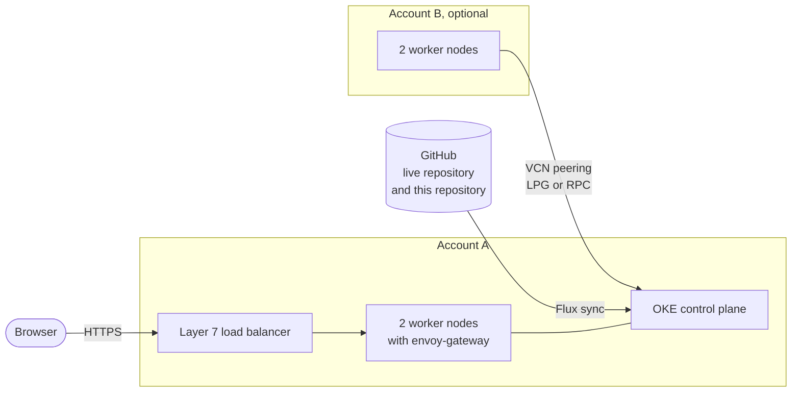
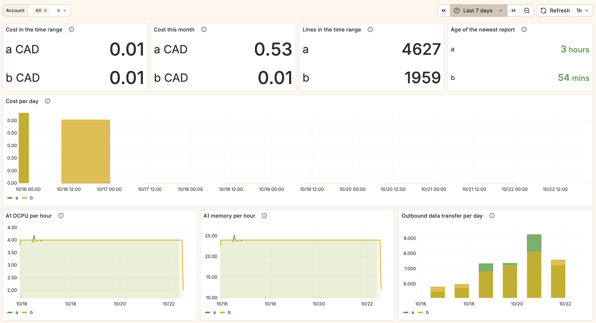
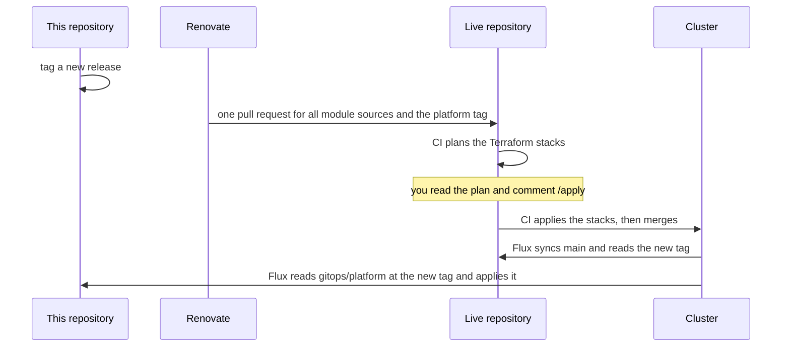

# OCI free tier Kubernetes modules

This repository has Terraform modules and Flux apps for a Kubernetes cluster on
the Oracle Cloud [Always Free tier][oci-free-tier]. The cluster costs nothing per
month. With one free tier account, it has two worker nodes. With a second
account, it has four worker nodes.

You do not run Terraform or Flux from this repository. You run them from a
second, private repository: the live repository. The live repository holds your
own values and pins this repository to one release tag.

This repository is a fork of [nce/oci-free-cloud-k8s][upstream].
[README.legacy.md](README.legacy.md) has the original README, with background
notes and the history of Kubernetes upgrades.

[oci-free-tier]: https://docs.oracle.com/en-us/iaas/Content/FreeTier/freetier_topic-Always_Free_Resources.htm
[upstream]: https://github.com/nce/oci-free-cloud-k8s

Contents:

1. [What the modules make](#what-the-modules-make)
2. [A running cluster](#a-running-cluster)
3. [Repository layout](#repository-layout)
4. [How the two repositories work together](#how-the-two-repositories-work-together)
5. [Requirements](#requirements)
6. [Set up a live repository](#set-up-a-live-repository)
7. [One account or two accounts](#one-account-or-two-accounts)
8. [Flux and the first apply](#flux-and-the-first-apply)
9. [Vault secrets](#vault-secrets)
10. [Add your own apps](#add-your-own-apps)
11. [Update to a new release](#update-to-a-new-release)
12. [Test a change before a release](#test-a-change-before-a-release)
13. [Changes from upstream](#changes-from-upstream)
14. [License](#license)

## What the modules make

| Part | Content |
| --- | --- |
| Account A | The OKE cluster in the home region of account A, and a node pool of two `VM.Standard.A1.Flex` nodes |
| Account B (optional) | Two more `VM.Standard.A1.Flex` nodes in the home region of account B. They join the cluster through a VCN peering. |
| Ingress | envoy-gateway with Gateway API on the free layer 7 load balancer. Teleport uses the free layer 4 load balancer. |
| Login | Dex with GitHub as the identity provider. `HTTPRoute` objects use OIDC through envoy-gateway. |
| GitOps | The Flux operator. A GitHub webhook starts a sync, and Flux writes the commit status to GitHub. |
| Storage | Longhorn, with one pool in each account |

Account B is optional. Without account B, the cluster has only the OKE nodes
in account A. [One account or two accounts](#one-account-or-two-accounts)
shows what changes.

All nodes are arm64. The free tier has no free x86 instances.

With two accounts, the accounts can use any home region. The free tier resources are only
in the home region of an account. If the two home regions are the same, the
VCNs peer with local peering gateways (LPG). If the regions are different,
the VCNs peer with remote peering connections (RPC) on a dynamic routing
gateway (DRG).

Oracle changed the free tier in June 2026. An account without a credit card
gets half of the resources. A pay-as-you-go account still gets 4 OCPUs and
24 GB of memory.

The cluster in account B is not supported by Oracle. The account B nodes join
with the kubelet TLS bootstrap and a bootstrap token. An OKE change can stop
this setup at any time. [README.legacy.md](README.legacy.md#worker-nodes-from-a-second-account)
explains the setup.



## A running cluster

This is a cluster with two accounts in one region. The first two nodes are
the OKE nodes of account A. The other two nodes are in account B.

```
$ kubectl get nodes -o wide
NAME         STATUS   ROLES    AGE    VERSION   INTERNAL-IP   OS-IMAGE                  CONTAINER-RUNTIME
10.0.1.116   Ready    node     6d8h   v1.37.0   10.0.1.116    Oracle Linux Server 9.8   cri-o://1.36.3-48.c6cc2c5b5b6.el9
10.0.1.36    Ready    node     6d8h   v1.37.0   10.0.1.36     Oracle Linux Server 9.8   cri-o://1.36.3-48.c6cc2c5b5b6.el9
10.1.1.239   Ready    <none>   6d1h   v1.37.0   10.1.1.239    Oracle Linux Server 9.8   cri-o://1.37.2
10.1.1.250   Ready    <none>   6d5h   v1.37.0   10.1.1.250    Oracle Linux Server 9.8   cri-o://1.37.2
```

The Grafana dashboard "OCI Cost" shows the cost of each account. In this
example, account A cost 0.53 CAD and account B 0.01 CAD in this month.



## Repository layout

| Path | Content |
| --- | --- |
| [terraform/modules](terraform/modules/) | The modules `account-a`, `account-b`, `cluster` and `github-oidc`. [terraform/README.md](terraform/README.md) describes them. |
| [gitops/infrastructure](gitops/infrastructure/) | cert-manager, cloudnative-pg, dex, envoy-gateway, external-dns, external-secrets, fluxcd-addons, kubelet-csr-approver, longhorn, metrics-server, snapshot-controller, teleport |
| [gitops/monitoring](gitops/monitoring/) | grafana, kube-prometheus-stack, loki, oci-cost |
| [gitops/tools](gitops/tools/) | jenkins |
| [gitops/platform](gitops/platform/) | The entry point for Flux. It lists the three folders above. |
| [gitops/account-b](gitops/account-b/) | The second entry point for Flux, only with account B: the Longhorn class `longhorn-account-b` and the cost collector of account B |
| [examples](examples/) | The Terraform root modules and the Flux entry point of a live repository |

Each app folder has a `flux.yaml` with its own Flux `Kustomization`. All of them
read from the `GitRepository` named `platform`.

## How the two repositories work together

```
live repository (private)                 this repository (public)
-------------------------                 ------------------------
terraform/accounts/a     --- module ----> terraform/modules/account-a
terraform/accounts/b     --- module ----> terraform/modules/account-b
terraform/clusters/oci   --- module ----> terraform/modules/cluster
gitops/clusters/oci      --- Flux ------> gitops/platform
  cluster-vars.yaml        (one tag, for example v0.1.1)
  apps of your own
```

You can make the live repository from the template repository
[oci-free-cloud-k8s-starter](https://github.com/Laobei2012/oci-free-cloud-k8s-starter).
Click "Use this template" on GitHub. The copy has the folders on the left and a
CI, and it uses one release tag of this repository. [Set up a live
repository](#set-up-a-live-repository) has the steps.

Terraform reads a module with a git source and a `?ref=` tag. Flux reads
`gitops/platform` with a `GitRepository` that has the same tag. Flux replaces
each `${name}` in the apps with the value from the ConfigMap `cluster-vars` of
the live repository.

## Requirements

- One Oracle Cloud free tier account A, and optionally a second account B
- Terraform 1.12 or later, for the `oci` backend
- The `oci` CLI, with a profile for each account in `~/.oci/config`
- A domain in Cloudflare, for cert-manager and external-dns
- A GitHub organization, a GitHub App for Flux, and OAuth apps for Dex and Teleport

If the home regions of the two accounts are different, account A must
subscribe to the home region of account B. The requestor of a remote peering
must subscribe to the region of the acceptor. You cannot remove a region
subscription again. If the home regions are the same, you do not need a
subscription.

## Set up a live repository

You can start from the template repository, or you can copy the examples by hand. Use the template repository, unless you already have a repository with its own CI.

### From the template repository

The template repository [oci-free-cloud-k8s-starter](https://github.com/Laobei2012/oci-free-cloud-k8s-starter) has these parts:

1. The Terraform stacks of account A, account B and the cluster.
2. The GitHub OIDC login of each account.
3. The Flux entry point and `cluster-vars.yaml`.
4. A CI that plans each pull request and applies on `/apply`.
5. Renovate, which bumps the module tag in Terraform and in Flux together.

Click "Use this template" on GitHub, then do the first-run steps in its README.

### By hand

1. Create a private repository.
2. In account A, create a bucket for the Terraform states:
   ```
   oci os bucket create --name terraform-states --versioning Enabled --compartment-id <tenancy_id>
   ```
3. Copy `examples/terraform/account-a` to `terraform/accounts/a` in the live repository.
4. Only with account B: copy `examples/terraform/account-b` to `terraform/accounts/b`.
5. Copy `examples/terraform/cluster` to `terraform/clusters/oci`.
6. In each `main.tf`, change the module `source` to the git URL in the comment above it.
7. In each stack, copy `backend.hcl.example` to `backend.hcl` and set your object storage namespace.
8. In each stack, copy `terraform.tfvars.example` to `terraform.tfvars` and set your values.
9. Create the vault secrets in the table below.
10. Apply `terraform/accounts/a`, then `terraform/accounts/b` if you use account B, then `terraform/clusters/oci`.
11. Copy `examples/gitops/clusters/example` to `gitops/clusters/oci`, and set your values in `cluster-vars.yaml`. Without account B, remove `platform-account-b.yaml`.

Run each stack with these commands:

```
terraform init -backend-config=backend.hcl
terraform apply
```

The stack `accounts/a` writes the kubeconfig to `terraform/.kube.config`. The
other stacks use this file. The file has no credentials, because the `oci`
CLI makes the token.

## One account or two accounts

Without account B, leave out `account_b_tenancy_id` and the other `account_b_`
values in `accounts/a`. The module then makes no peering. You do not need the
stack `accounts/b`, the file `platform-account-b.yaml`, or the value
`oci_zone_prefix_b`. Loki runs on the OKE nodes and uses the default Longhorn
class.

With account B, set `region` and `account_b_region` in `accounts/a`, and `region` and
`account_a_region` in `accounts/b`. The modules compare the two regions and
select LPG or RPC.

The peering of the two accounts needs two runs of `accounts/a`. The first run
makes the requestor in account A. Then `accounts/b` makes the acceptor. It
outputs `rpc_id` if the regions are different, or `lpg_id` if they are the
same. Set `account_b_rpc_id` or `account_b_lpg_id` in `accounts/a` to this
value, and apply `accounts/a` again. The output `account_b_peering_status`
must be `PEERED`.

The stacks `accounts/a` and `accounts/b` also output `zone_prefix`. Set these
values as `oci_zone_prefix_a` and `oci_zone_prefix_b` in `cluster-vars.yaml`.
Longhorn uses the zones to keep the volumes of each account on its own nodes.
If the two regions are the same, the account B zones get the suffix `-B`, for
example `PHX-B-AD-1`.

With account B, you can also move Loki to the account B nodes. Set
`loki_node_label: tenancy`, `loki_node_value: account-b` and
`loki_storage_class: longhorn-account-b` in `cluster-vars.yaml`. Set these
values before the first install of Loki. Kubernetes cannot change the storage
class of an existing Loki volume.

## Flux and the first apply

The module `cluster` installs the Flux operator. Flux then syncs
`gitops/clusters/oci` of the live repository. If the first apply of
`clusters/oci` fails on the `ClusterSecretStore`, wait until Flux installs
external-secrets, and apply again.

## Vault secrets

The module `cluster` creates an OCI vault store for external-secrets. You create
these secrets in the vault before the first apply:

| Vault secret | Read by |
| --- | --- |
| `terraform-gh-token` | The module `cluster`, for Flux |
| `terraform-github-app-pem` | The module `cluster`, for the GitHub App of Flux |
| `cloudflare-api-token` | cert-manager, external-dns |
| `GITHUB_DEX_CLIENT_ID`, `GITHUB_DEX_CLIENT_SECRET` | dex |
| `dex-envoy-client-secret` | dex, envoy-gateway, fluxcd-addons, longhorn, kube-prometheus-stack, jenkins |
| `dex-grafana-client` | dex, grafana |
| `fluxcd-github-token` | fluxcd-addons, for the commit status |
| `fluxcd-slack-webhook` | fluxcd-addons, the bot token of the Slack app |
| `SLACK_API_URL` | kube-prometheus-stack, the Alertmanager webhook |
| `PAGERDUTY_ROUTING_KEY` | kube-prometheus-stack |
| `teleport-github-client-secret` | teleport |

The cluster writes these secrets itself: `github-flux-webhook-token`,
`oci-cost-db-grafana`, and the `prometheus-remote-write-*` secrets.
[terraform/README.md](terraform/README.md#vault-secrets) shows the command that
creates a secret.

## Add your own apps

Put the apps that only your cluster needs in the live repository, for example
in `gitops/apps`. Their Flux `Kustomization` uses the `GitRepository`
`flux-system`, which is the live repository.

Jenkins reads its agents and jobs from the optional ConfigMap
`jenkins-site-values` in the namespace `jenkins`. Put your JCasC
`configScripts` in its key `values.yaml`. Give the ConfigMap the label
`reconcile.fluxcd.io/watch: Enabled`, so that a change starts a Helm upgrade.

## Update to a new release

Use the same tag in all module sources and in the `GitRepository` `platform`.
If the tags differ, Terraform and Flux run different versions of the code.



Renovate can update all tags in one pull request. Its terraform manager finds
the module sources. Its flux manager does not read the tag of a
`GitRepository`, so a regex manager finds it. Add this configuration to
`renovate.json` in the live repository:

```json
{
  "customManagers": [
    {
      "customType": "regex",
      "managerFilePatterns": ["/^gitops/clusters/.+/platform-source\\.yaml$/"],
      "matchStrings": [
        "url: https://github\\.com/(?<depName>\\S+?)(?:\\.git)?\\s+ref:\\s+tag: (?<currentValue>\\S+)"
      ],
      "datasourceTemplate": "github-tags"
    }
  ],
  "packageRules": [
    {
      "matchPackageNames": ["Laobei2012/oci-free-cloud-k8s-module"],
      "groupName": "oci-free-cloud-k8s-module"
    }
  ]
}
```

Before you apply a new release, read the `terraform plan` of each stack.

## Test a change before a release

1. Push the change to a branch of this repository.
2. In the live repository, set each module `?ref=` to the branch name.
3. Run `terraform init -upgrade` and `terraform plan` in each stack.
4. To test the apps, run `flux suspend kustomization flux-system`. Otherwise Flux sets the tag again at the next sync.
5. Point the `GitRepository` `platform` at the branch. Flux ignores a branch while the tag is set, so remove the tag:
   ```
   kubectl -n flux-system patch gitrepository platform --type merge -p '{"spec":{"ref":{"tag":null,"branch":"<branch>"}}}'
   ```
6. After the test, run `flux resume kustomization flux-system`, and set each module `?ref=` to the tag again.

CI runs on each pull request of this repository. It runs `terraform validate`
on the modules and the examples. It builds each Kustomization, replaces the
variables with the example values, and validates the result with kubeconform.
It also runs gitleaks.

## Changes from upstream

The fork starts at upstream commit [228d056][upstream-base] of 2026-09-21. The
list shows the main changes after that commit, in this repository and in the
private live repository that this repository came from.

The structure:

1. The Terraform stacks became the modules `account-a`, `account-b`, `cluster`
   and `github-oidc`. A live repository calls them at a release tag.
2. A live repository applies all shared Flux apps with one Kustomization of
   `gitops/platform`, at the same tag.
3. The template repository
   [oci-free-cloud-k8s-starter](https://github.com/Laobei2012/oci-free-cloud-k8s-starter)
   is a live repository that you can copy.

The accounts and the nodes:

1. An optional second free tier account B adds two worker nodes. Its VCN
   peers with the VCN of account A, and its nodes join the OKE cluster.
   Without account B, the modules make no peering resources.
2. `kubelet-csr-approver` approves the serving certificates of the account B
   nodes.
3. The accounts can use any home region. In the same region, the VCNs peer
   with local peering gateways. Else they use remote peering connections.
4. The node pool of account A works in a region with one availability domain.
5. The OKE nodes always use Oracle Linux 9.

The CI login:

1. The module `github-oidc` lets GitHub Actions log in to OCI with an OIDC
   token. GitHub stores no OCI API key.
2. The template repository has the plan and apply CI. It plans each pull
   request and applies on a `/apply` comment.
3. In the template repository, the CI plan user can only read in Kubernetes.

The new apps:

1. Jenkins, with Dex login and Prometheus metrics.
2. Loki and Alloy, for logs, with a Grafana dashboard.
3. CloudNativePG, for the databases of Grafana and `oci-cost`.
4. `oci-cost`, which runs
   [oci-cost-collector](https://github.com/Laobei2012/oci-cost-collector) to
   collect the OCI costs of each account each hour. It
   shows them in Grafana. If an account costs more than 1 in its billing
   currency in one month, it sends an alert.
5. The CSI snapshot controller, for Longhorn snapshots.
6. The Flux Operator web UI, with Dex login.

The removed apps are `lychee`, `s3-proxy` and the Grafana OCI metrics plugin.

The monitoring:

1. Jenkins, Longhorn, Envoy, Dex, cert-manager and external-secrets export
   Prometheus metrics. Grafana has a dashboard for most of them.
2. Prometheus has alert rules for the apps. Alertmanager sends alerts to Slack,
   and critical alerts to PagerDuty, grouped by alert name.
3. Prometheus keeps 35 days of metrics, with a size limit that leaves free
   disk space.

The changes to the apps:

1. Envoy runs two replicas on different nodes, only on the load balancer
   backend nodes. It keeps encoded slashes in the request path.
2. Longhorn mounts new volumes with the discard option and trims the
   filesystems each week. Account B nodes have their own Longhorn pool.
3. After a Longhorn upgrade, Longhorn moves the volumes to the new engine
   automatically.
4. Teleport retries a failed upgrade, and does not stall.
5. Flux reads its GitHub and Slack tokens from the OCI vault. Old health
   checks no longer block a new revision.
6. The apps read the values of one installation from `cluster-vars`, for
   example the domain, the zones and the Slack channel.

[upstream-base]: https://github.com/nce/oci-free-cloud-k8s/commit/228d0569d24ab91755b0c69a339c9ca1f6d5c58e

## License

This repository and the upstream repository have no LICENSE file.
